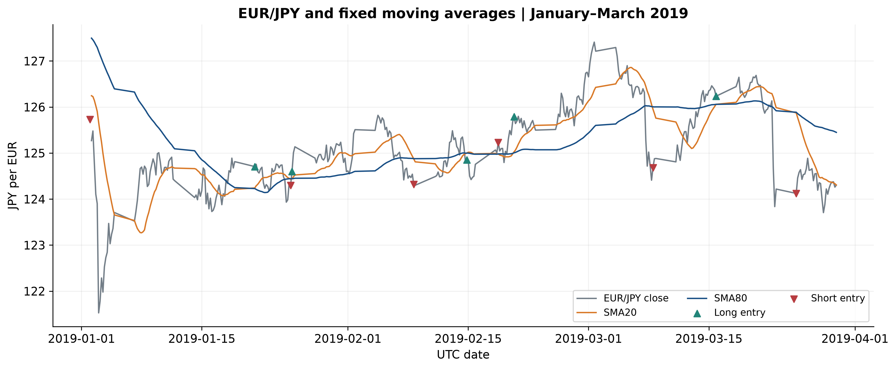
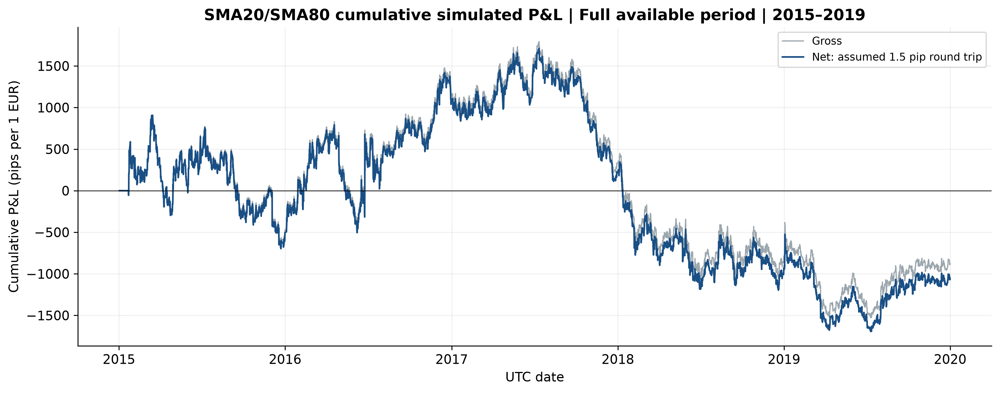

# EUR/JPY Quantitative Trading Research

*An Independent Study of Moving-Average Trend Following*

## Project overview

This project explores whether a simple, rule-based trading strategy can generate profits in the EUR/JPY currency market. After previously attempting to automate a more complicated trading strategy based on my own manual trading experience, I decided to develop a simpler model that could generate more trades and provide results that were easier to evaluate.

Using Python, I built a moving-average trading model that analyzes historical EUR/JPY prices, generates buy and sell signals, and simulates trades over five years of market data. I then evaluated its performance, including trading costs, risk, and comparisons against a basic buy-and-hold strategy.

Although the model did not generate a profit, the project demonstrates the process of developing a quantitative trading system, testing a hypothesis, and drawing conclusions from historical evidence.

## Research question

Can a simple moving-average trend-following strategy generate positive net trading returns in EUR/JPY after estimated transaction costs?

## How the model works

Each four-hour candle summarizes opening, highest, lowest and closing prices. The fast moving average uses 20 completed candle closes; the slow average uses 80. The model holds **long** exposure when the fast average is higher and **short** exposure when it is lower. Long exposure gains when price rises; short exposure gains when price falls. Equality retains the prior direction.

Signals use completed candles and execute changes at the next observed UTC four-hour opening. The backtest simulates these rules chronologically, trading one EUR at a time. Estimated costs are 1.5 pips per round trip, divided between entry and exit; one EUR/JPY pip is 0.01 JPY per EUR. Results use fixed-unit P&L, not leveraged account returns. SMA20/SMA80 are unchanged across all periods; no machine learning or optimization is used.

Historical EUR/JPY market data is attributed to [London Strategic Edge](https://londonstrategicedge.com). The project's private permission record is described in [data provenance](docs/DATA_PROVENANCE.md); it reports support approval for the requested derived materials, conditional on relevant credit. Raw historical price data is not redistributed. This does not establish broader data rights or provider endorsement.

## Results

I tested the model using 124,361 historical fifteen-minute EUR/JPY price records from 2015 through 2019, prepared into 7,505 complete four-hour candles.

| Period | Completed trades | Strategy net pips | Passive long net pips |
|---|---:|---:|---:|
| Development 2015-2018 | 95 | **−940.8** | −1,103.6 |
| Evaluation 2019 | 26 | **−121.0** | −389.7 |
| Continuous 2015-2019 | 120 | **−1,064.8** | −1,487.3 |

*Note:* Results from the separate periods differ slightly from the continuous five-year backtest because positions are handled differently at the end of 2018. The 3.0-pip difference is explained in the [accounting review](docs/ACCOUNTING_REVIEW.md); the underlying figures are in the [performance summary](research_summary/performance_summary.csv).

## Visualizations

These charts present independent calculations from the credited historical data; all simulations retain their negative performance disclosures.

**Prices and moving-average signals**



*Source: historical data from [London Strategic Edge](https://londonstrategicedge.com); independent research calculations.*

**Continuous strategy performance before and after assumed costs**



*Source: historical data from [London Strategic Edge](https://londonstrategicedge.com); independent research calculations.*

**Strategy versus passive long on the same performance scale**


*Source: historical data from [London Strategic Edge](https://londonstrategicedge.com); independent research calculations.*

## Key findings

Across 120 completed trades in the continuous five-year test, the strategy **lost 1,064.8 pips** after estimated costs. It performed better than simply holding a long EUR/JPY position over comparable dates, but both approaches lost money.

The strategy also lost money **before** trading costs. Higher assumed costs increased its losses, as shown in the [cost-sensitivity results](research_summary/cost_sensitivity.csv). The project shows why a working trading algorithm and more trade opportunities do not necessarily lead to profit—and why historical results cannot establish reliable predictions about future prices.

## Research paper

Read the [complete five-page paper](docs/EURJPY_V3_research_paper.pdf) or the [Markdown version](docs/research_paper.md). It explains why I moved from a complex trading approach to a simpler strategy, how I tested it, what I found, and the limitations of the results.

## Reproducing the experiment

The **October 25, 2026** verification used **Python 3.14.3 on Windows in an existing isolated environment**. Installed runtime and test versions matched every lock pin and `pip check` passed; this was not a fresh environment installation. See the dated [reproduction record](security/fresh_reproduction.json) and [release checklist](docs/RELEASE_CHECKLIST.md). Main packages are pandas, numpy, matplotlib and pytest. `requirements-lock.txt` pins the tested runtime and test dependencies; `requirements.txt` lists runtime-only packages. The commands below describe how a reader can create a new environment; no new installation or research rerun was performed for the October 28 documentation cleanup.

From this directory in PowerShell:

```powershell
python -m venv ../eurjpy_v3_env
..\eurjpy_v3_env\Scripts\python.exe -m pip install -r requirements-lock.txt
..\eurjpy_v3_env\Scripts\python.exe -B -m pytest v3/tests -q -p no:cacheprovider
..\eurjpy_v3_env\Scripts\python.exe -B -m v3.run --data "PATH_TO_AUTHORIZED_CSV" --output "../eurjpy_v3_local_results"
..\eurjpy_v3_env\Scripts\python.exe -B -m v3.validate_artifacts --data "PATH_TO_AUTHORIZED_CSV" --output "../eurjpy_v3_local_results"
```

With an activated environment, `python` can replace the interpreter path. The CSV needs `timestamp,symbol,open,high,low,close`; `volume` is optional. Supply unique, chronological UTC quarter-hour candle-open timestamps, symbol `EUR/JPY`, valid positive OHLC, and coverage of both prescribed periods. Historical data is not bundled. Supply an authorized CSV; no API connection or key is required. Installing packages is separate from the offline backtest.

These commands keep the environment and full results outside the release candidate and suppress local test/bytecode caches. Full ledgers, equity journals, tables, audits and six charts go to the sibling directory `../eurjpy_v3_local_results`. Without `--output`, the program defaults to ignored `local_results/`; keep private files outside the candidate for its all-file publication scan. The optional `tools/build_review_charts.py --results PATH --output PATH` rebuilds comparison figures with documented plotting packages. Keep its output private too.

## Limitations

This is historical simulation, not live trading. Costs are estimates; funding/swap, variable spreads, latency and actual execution are not fully modeled. The sample is limited, sampled drawdown can miss worse intrabar losses, and prior work inspected 2019 structure, so it is not an untouched holdout. Timestamp/quote metadata remain uncertain. P&L does not establish predictive power or dependable future returns.

**Publication and data rights:** This repository is public as of the October 28, 2026 review. The project record reports London Strategic Edge support permission for the requested derived statistics, charts, and research paper with relevant credit; the private correspondence was not independently re-authenticated in this cleanup. This is not a general data license or an endorsement, and the underlying historical market data is not redistributed. See [data provenance](docs/DATA_PROVENANCE.md) and [security checks](SECURITY.md). The [release checklist](docs/RELEASE_CHECKLIST.md) distinguishes the current public status from the preserved October 25 preparation record.

**Code licensing:** No public software license has been granted for the original code at this time. A license can be added later by the copyright holder. This does not affect the provider's rights in the source data.

*Implementation and editorial preparation used AI assistance. The project does not claim unaided authorship, awards, or real-money trading profits.*
