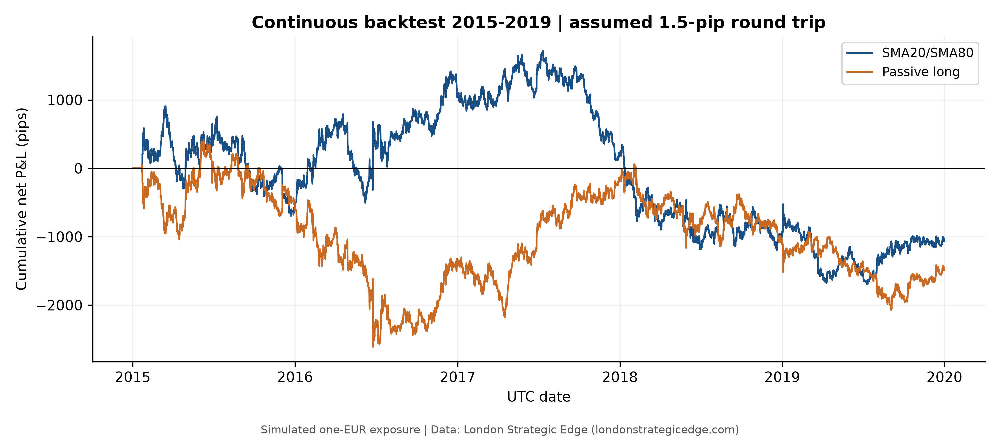
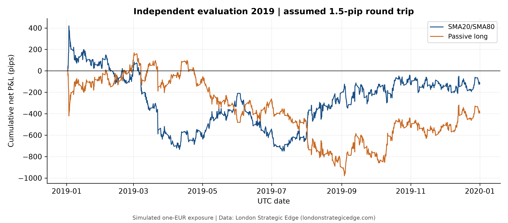

# Testing simple trend following in EUR JPY

Fixed SMA20 and SMA80 rules on four-hour candles from 2015 through 2019

Alex Swano | Independent Finance Research | October 17, 2026

## Abstract

This study investigates whether a simple moving-average trading strategy can generate a profit in the EUR/JPY currency market after estimated trading costs. I developed a Python program that analyzes historical price data and uses two moving averages, calculated over 20 and 80 four-hour periods, to determine when to buy or sell EUR/JPY. The strategy was tested on historical data from 2015 through 2019 without changing its rules or parameters.

At an assumed trading cost of 1.5 pips per completed trade, the model lost 940.8 pips during the 2015–2018 development period, 121.0 pips during the separate 2019 evaluation, and 1,064.8 pips across the continuous five-year backtest. All three tests produced losses even before trading costs. Although the strategy outperformed simply holding a long EUR/JPY position, it did not demonstrate profitability. The findings show the value of testing a trading idea against historical evidence rather than assuming that a functioning strategy will generate profits.

## Research Motivation

My first attempt at developing an automated EUR/JPY trading model was based on the strategies I had previously used when trading manually. I wanted to translate my own decision-making process into code, using concepts such as market structure, supply and demand zones, and price movements. However, translating these ideas into strict rules made the model increasingly complicated. With so many conditions required for a trade, the system generated very few opportunities, making it difficult to meaningfully evaluate its performance.

Rather than continue adjusting the original strategy, I decided to take a simpler approach. For V3, I abandoned the complicated price-action rules and developed a moving-average strategy that could generate more trading opportunities and produce results that were easier to analyze. My goal was to build a model that could be consistently tested, evaluated, and improved based on actual historical evidence.

## Historical Data and Preparation

The model uses historical EUR/JPY price data provided by London Strategic Edge, containing 124,361 fifteen-minute price records from 2015 through 2019. Each record includes the opening, highest, lowest, and closing price during that period. Before testing the strategy, I checked the dataset for duplicate timestamps and inconsistent price values. No issues were found in these checks.

I reused the historical data collected for my earlier model and prepared it for the new strategy's four-hour timeframe. Only complete four-hour periods were used to calculate the moving averages, and missing prices were not estimated or filled in. This resulted in 7,505 complete four-hour candles available for analysis.

## Trading Strategy and Execution

The model uses two simple moving averages (SMAs) to identify trends in the EUR/JPY currency market. A simple moving average calculates the average closing price over a specified number of periods, helping smooth out short-term price fluctuations. The SMA20 uses the 20 most recent four-hour closing prices, while the SMA80 uses the most recent 80. The shorter average responds more quickly to price changes, while the longer average provides a broader view of the market's direction.

The strategy compares these two averages to determine when to enter and exit trades. When the SMA20 is above the SMA80, the model takes a **long position (buying EUR/JPY)**, anticipating that the price will rise. When the SMA20 is below the SMA80, the model takes a **short position (selling EUR/JPY)**, anticipating that the price will fall.

Rather than setting fixed profit targets or stop-loss levels, the model holds each position until the averages indicate a change in direction. When an opposite signal occurs, the existing trade is closed and a new trade is opened in the opposite direction. Any remaining position is closed at the end of the backtest.

To ensure the model only uses information available at the time, trading signals are calculated after each four-hour period is completed, and trades are executed at the next available opening price.

## Measuring Profit, Loss, and Trading Costs

To measure the performance of each trade, the model calculates profits and losses in pips, a standard unit used to measure currency price movements. For EUR/JPY, one pip represents a price change of 0.01 Japanese yen per euro. For example, if EUR/JPY rises from 160.00 to 160.50, that represents an increase of 50 pips. A long position profits from this increase, while a short position would lose 50 pips.

The backtest uses a fixed position size of one euro to keep calculations consistent. Rather than assuming a particular trading account balance or amount of leverage, the model reports performance in pips. This allows the results to be evaluated without introducing assumptions about how much money would have been invested.

Trading costs are also included to make the simulation more realistic. The model assumes a total cost of 1.5 pips for each completed trade, divided equally between entering and exiting a position. For example, a trade earning 50 pips before costs would produce a net profit of 48.5 pips after costs.

The model tracks both completed trades and gains or losses on positions that remain open. At the end of each backtest, any remaining position is closed so that its final profit or loss is included in the results.

## Testing and Evaluation

To evaluate the strategy, I divided the historical data into two periods: 2015–2018 for development and 2019 for evaluation. Separating the data allowed me to examine how the same strategy performed outside its development period rather than adjusting the model based on all available results. This helps reduce the risk of overfitting, which occurs when a model is too closely tailored to historical data and struggles to perform on new data. Although this version does not use machine learning, separating development and evaluation data is an important practice for more advanced predictive models I may explore in the future.

I also ran the strategy continuously across all five years to measure its overall performance and compared the results against simply buying and holding EUR/JPY. The trading rules and parameters remained unchanged throughout testing.

To verify that the model was functioning correctly, I ran 32 automated tests and 18 accounting checks covering trade execution, transaction costs, and profit calculations. The standalone program successfully reproduced the same results.

## Backtest Results

Table 1 summarizes how the trading strategy performed during the 2015–2018 development period, the separate 2019 evaluation, and the full five-year backtest. For each period, it shows the number of completed trades, profit or loss before trading costs (gross), estimated trading costs, and the final profit or loss after costs (net). The final column compares the strategy against simply buying and holding EUR/JPY over comparable dates. All results are measured in pips.

Table 1. Simulated pips per one EUR of fixed exposure. Passive long uses comparable first-entry and terminal-exit times. Data: London Strategic Edge (https://londonstrategicedge.com); independent calculations.

| Period | Trades | Gross (pips) | Costs (pips) | Net (pips) | Buy & Hold (pips) |
|---|---:|---:|---:|---:|---:|
| 2015–2018 | 95 | −798.3 | 142.5 | −940.8 | −1,103.6 |
| 2019 | 26 | −82.0 | 39.0 | −121.0 | −389.7 |
| Full period | 120 | −884.8 | 180.0 | −1,064.8 | −1,487.3 |

**Note:** The results from the two separate testing periods differ slightly from the continuous five-year results because trades are handled differently at the boundary between 2018 and 2019.

The strategy lost money in every period, even before accounting for trading costs. However, it performed better than simply buying and holding EUR/JPY. This means that while the model did not generate a profit, it produced smaller losses than the benchmark during the historical period tested.

Figure 1. Continuous strategy and passive long cumulative net P&L. Both finish below zero; the strategy ends 422.5 pips above the losing benchmark. Data: London Strategic Edge (https://londonstrategicedge.com); independent calculations.

## Key Findings

### Development Period (2015–2018)

During the development period, the model completed 95 trades and lost 940.8 pips after estimated trading costs. Simply buying and holding EUR/JPY over comparable dates would have resulted in a loss of 1,103.6 pips. Although the strategy outperformed the benchmark, it still lost money even before accounting for trading costs.

These results showed that the moving-average strategy was able to generate significantly more trading opportunities than my original model, but increasing the number of trades did not necessarily lead to profitability.

### Evaluation Period (2019)

To further evaluate the strategy, I tested it separately on historical data from 2019, keeping the same trading rules and parameters. During this period, the model completed 26 trades and lost 121.0 pips after estimated costs, compared with a loss of 389.7 pips from simply buying and holding EUR/JPY.

The results followed a similar pattern to the development period. The strategy outperformed the benchmark but remained unprofitable. This suggested that although the model could reduce losses relative to a long position during the periods tested, it was not consistently able to generate positive returns.

Figure 2. Independent 2019 net P&L. The evaluation starts flat; earlier indicator history is used without earlier trades or P&L. Data: London Strategic Edge (https://londonstrategicedge.com); independent calculations.

Across the full five-year backtest, the model completed 120 trades, with 45 profitable trades and 75 losing trades, resulting in a win rate of 37.5%. Although the average winning trade gained 177.2 pips compared with an average loss of 120.5 pips, the strategy lost more frequently than it won. As a result, the larger winning trades were not enough to offset the more frequent losses.

The strategy also experienced a maximum drawdown of 3,405.6 pips during the full backtest. Drawdown measures how much a strategy's accumulated performance falls from a previous high point. This shows that the model experienced substantial declines in performance, even though some individual trades were profitable.

Overall, the results suggest that while the moving-average strategy was capable of identifying some profitable price movements, it was not consistently successful at generating profits. Its performance relative to simply holding EUR/JPY was better, but that does not necessarily mean the strategy could reliably predict future price movements.

## Limitations

This study only evaluates the strategy using historical EUR/JPY data from 2015 through 2019, so its results do not necessarily reflect how the model would perform in other markets or time periods. Additionally, the backtest uses estimated trading costs and does not fully account for real-world factors such as slippage, financing costs, and differences in execution prices. Although 2019 was evaluated separately, some of that data had been examined during earlier model development, meaning it was not a completely untouched testing period.

## Conclusion

The moving-average strategy did not generate a profit during the 2015–2018 development period, the separate 2019 evaluation, or the full five-year backtest. Although it performed better than simply buying and holding EUR/JPY, both approaches lost money. These results showed that generating more trading opportunities and building a functioning model do not necessarily lead to a profitable strategy.

The main takeaway from this project was learning how to turn a trading idea into a working program, test it using historical data, and evaluate its performance based on actual results. In the future, I would like to explore more advanced strategies, test them on new market data, and consider additional factors that could influence currency movements.

## Data Attribution

Historical EUR/JPY price data was provided by [London Strategic Edge](https://londonstrategicedge.com/). The research findings and visualizations are presented with the provider's permission and appropriate attribution. The original historical dataset is not redistributed.

## References and reproducibility

[1] London Strategic Edge. Terms of Service, Sections 6-9. https://londonstrategicedge.com/terms/ (rendered page reviewed October 15, 2026).

[2] London Strategic Edge. Official lse-data README, Licence section. https://github.com/londonstrategicedge/lse-data#licence (reviewed October 15, 2026).

Project evidence: docs/ACCOUNTING_REVIEW.md; research_summary/performance_summary.csv; security/fresh_reproduction.json. Reproduction requires an appropriately authorized local CSV; data is not redistributed.

I chose the research direction and simplified moving-average approach, reviewed and interpreted the results, and refined the paper. AI tools assisted with Python implementation, test execution, computational validation, and editorial preparation.
